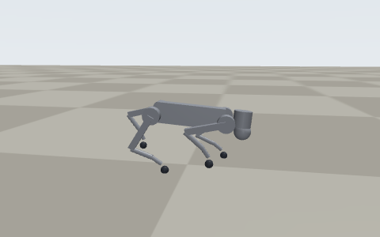
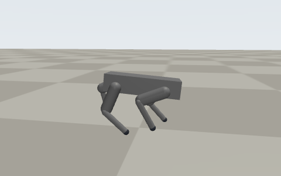
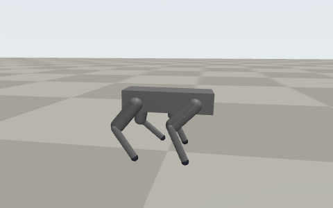

<p align="center">
  
</p>

# Bolt: a robot dog brain, trained in simulation

Brains for two real quadrupeds, the **Unitree Go2 EDU** and the **DEEP Robotics Lite3**, learned from real dog motion
capture with reinforcement learning in MuJoCo, plus the robot program that runs them through each maker's own SDK.
Walk, trot, pace, canter, turns, sit, lie, get up, steering, and getting back up after a fall. Everything here is
**simulation**: neither robot has run it yet.

[](train/deploy/PLAN.md)
[](train/deploy/HARDWARE_DAY.md)
[](models/)
[](train/colab/bolt_gpu.ipynb)

**Created and directed by Arun Mallikarjun**, who set the goals, the targets and the rules and owns the project. The
code, training and write-ups were produced with AI assistance under his direction.

## Try it in a few minutes

```bash
git clone -b claude/robot-build-memory-ju76nt https://github.com/MrArun005/Cool-Websites && cd Cool-Websites
bash train/deploy/setup_go2.sh --sim --lite3      # pinned installs into ./bolt-deps, ends with the readiness check
source bolt-deps/env.sh && cd train
python deploy/sim_vendor.py --seconds 60 &        # Unitree's own Go2 simulator
python deploy/run_go2.py --plan "trot:6,sit:5,lie:6,getup:6,walk:6"
```

Train on a free GPU: open [`train/colab/bolt_gpu.ipynb`](train/colab/bolt_gpu.ipynb) in Google Colab, pick a run,
Runtime -> Run all.

## What's in it

| | |
|---|---|
| **Brains** | One brain per robot for all the motion (Go2 `damp-798M`, Lite3 `dog-61.8M`), a self-right brain each; numpy only on the robot, no torch |
| **Robot program** | `run_go2.py`: Unitree's unitree_sdk2 (DDS) or DEEP's UDP joint protocol through a C++ bridge to their MotionSDK; one setting switches simulator and robot |
| **Safety** | eases in from the stance, keeps targets inside the joint limits, damping mode on a tilt, a stale state or a sustained over-speed |
| **Recovery** | fall -> self-right -> tuck -> get up -> carry on, on both robots |
| **Talk to it** | `--pet`: a local pet mind (moods, memory, jokes, tricks); `--remote`: the Go2's own wireless remote |
| **Training** | MuJoCo MJX + Brax PPO on 4,096 robots per GPU; delay, damping, motor-speed and push randomization; privileged critic and input history as options |
| **Checks** | one-command setup, readiness check, controller-vs-training parity to 1e-7, rehearsals on each maker's own model |

**Measured, not claimed.** On each maker's own MuJoCo model, stepped in lockstep with the robot program's inputs:
the Go2 brain finishes a 41 s trot / sit / lie / get-up / walk / canter routine 10 times out of 10 (also 10/10 with
5% of control steps lost and with 0-19 ms of command delay); both robots recover from 40 falls out of 40 (side, back,
tipped, shoved); the full routine also runs live, in real time, in Unitree's simulator. The Lite3 brain, with commands
3-15 ms late on DEEP's model, finishes 24 of 24 routines and 48 of 48 trot -> sit without a fall, but still falls in
the canter (2 of 12), so the robot program runs its canter as a trot; and the Go2's knees go past 1.2x their rated speed in ~0.5% of control steps at
Unitree's default joint damping. Every number, with the command that made it, is in
[`train/deploy/PLAN.md`](train/deploy/PLAN.md).

| Go2: trot, then sit | Lite3: trot, then canter | Lite3: lie down, get up, walk |
|---|---|---|
|  |  |  |

<sub>Rendered from the simulator with `train/research/render_gif.py`. Dog motion capture: CC BY-NC 4.0, so these
brains are for non-commercial use. Robot models: Unitree Go2 (BSD-3-Clause, MuJoCo Menagerie), DEEP Robotics Lite3
(BSD-3-Clause; MotionSDK MIT), copyright notices kept.</sub>

## Contact

[](https://linkedin.com/in/arunmallikarjun)
[](mailto:arunmallikarjun005@gmail.com)
[](https://arun-portfolio-kappa.vercel.app)

---

## Target robots: Unitree Go2 EDU and DEEP Robotics Lite3 (decided 30 Oct 2026)

Bolt's brains will be retrained for, and first run on, two real quadrupeds from two makers: a **Unitree Go2 EDU** (first)
and a **DEEP Robotics Lite3** (second). One code path, a body option per robot, separate brains and separate results per
body. Until a robot runs them, every result in this repo is **in simulation**.

| Why Lite3 as the second | |
|---|---|
| A different maker | not tied to one vendor's SDK or hardware |
| Official sim models | DEEP Robotics publishes Lite3 URDF and MJCF (github.com/DeepRoboticsLab, URDF_model) |
| Real-robot path | official RL sim-to-sim / sim-to-real code (Lite3_rl_deploy) and a low-level C++ MotionSDK; used in published learned-locomotion work deployed onboard at 50 Hz |
| Size class | a ~12-DoF small quadruped like Go2, so the same dog clips and brains fit after retargeting |

Licences checked (1 Nov): the Lite3 model files (DeepRoboticsLab/URDF_model, commit 52352f5) are **BSD 3-Clause**, the
low-level **Lite3_MotionSDK** is **MIT**, the official learned-policy deployment code (**Lite3_rl_deploy**) is **BSD 3-Clause**:
all three may be used and adapted with their copyright notices kept. What the official MJCF says: 11.94 kg, 12 joints,
all four knees bending the same way (like the Go2), torque-controlled motors at +-30 N·m, sideways hips +-0.52 rad.
The MotionSDK takes the same per-joint command as the Go2 program sends (target angle and speed, kp, kd, feed-forward
torque), so `train/deploy/` carries over with a new body entry. Nothing of it is copied into the repo yet.

### Unitree Go2 EDU

| Why Go2 | |
|---|---|
| Faster legs | ~30 rad/s hip/thigh drives vs the A1-class 21 rad/s that caps Bolt's canter today (knee 15.7 rad/s with a 45 N·m gear) |
| Proven fast in the real world | Unitree lists up to ~3.5-5 m/s running on Go2 (vendor figures) |
| Model ready | the official MuJoCo Menagerie Go2 (BSD-3-Clause, © Unitree) is already in [`train/robots/unitree_go2/`](train/robots/unitree_go2/) |
| Real-robot path | widely used for sim-to-real research; the **EDU** tier opens low-level joint control (unitree_sdk2), which a learned brain needs. Air/Pro do not |

What changes: Go2's knees all bend backward (Bolt's rear knees bend forward), its mass sits in the legs, and it stands
~0.30 m tall, so the dog clips are re-retargeted and **every brain is retrained** on the Go2 model. Then MasterMind is
re-distilled. The plan and the body comparison are in [`train/research/real_robot_port.md`](train/research/real_robot_port.md).
Before hardware: a body-speed estimator (Go2 does not measure body velocity), delay and sensor stress tests on the Go2
model, and a second-engine check.

- Training, environments and exams: [`train/README.md`](train/README.md)
- Rules of the project, what exists and what is next: [`HANDOFF.md`](HANDOFF.md)
- Techniques learned from open-source robots: [`docs/LESSONS.md`](docs/LESSONS.md)
- Talk to the browser version (physics, tricks, voice, offline): open [`pet/index.html`](pet/index.html)

The repo name is historical; everything below is the earlier material this project grew out of.

---

**Starting the new robot?** Read [HANDOFF.md](HANDOFF.md) first, then [docs/LESSONS.md](docs/LESSONS.md).

## 🦆 Bolt Duck (earlier plan)

A small two-legged robot pet you build yourself: the open-source Open Duck Mini v2 body (3D-printed, about $400 of parts) with Bolt's personality on top. Plan, parts, build steps and links: [`duck/README.md`](duck/README.md).

## 🐕 Robot dog sim

Open `pet/index.html`. Everything it needs is in the repo, so it works offline. It's a physics-simulated robot dog you can talk to, by typing or with your voice. It can sit, jump, jump around, backflip, somersault, roll over, play dead, shake, beg, dance and tell jokes, and it talks back. Every jump is real ballistics with conserved angular momentum, and the panel shows the leg force and energy each trick needs. It remembers its name and logs your feedback as training data.

The plan for what comes next (full physics with learned tricks, understanding people and humor, then a real body) is in [`pet/ROADMAP.md`](pet/ROADMAP.md).

```bash
node --test pet/test/*.test.js   # physics, trick and brain tests
```

### Training the real-physics dog

[`train/`](train/README.md) has Bolt as a MuJoCo physics model (12 motors, real contacts and friction) and a reinforcement-learning setup that teaches it to stand, sit, lie down and walk on command. It trains on a normal 4-core CPU in about an hour. The roadmap includes a [budget](pet/ROADMAP.md#budget) for every phase.

## 🤖 Build a Robot

Open `index.html` in a browser for an interactive guide to building your first robot. It covers:

- **Robot lab:** move the head and arm servos with sliders, and see the serial commands the brain sends
- **Anatomy:** what each part does (brain, spinal cord, muscles, senses, heart)
- **Memory & RAM:** a hands-on demo of RAM versus storage
- **Shopping list**, **8 build steps** and **safety rules**

The real robot code is in [`robot/`](robot/README.md): a Python brain with memory for the Raspberry Pi, and Arduino firmware for the limbs. You can try the brain right now without any hardware:

```bash
cd robot/brain && python3 brain.py
```
