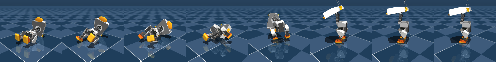

# Hybrid duck: Microduck body + the owner's duck head

## Main robot: every skill, through one runtime (`runtime_hybrid.py`)

The hybrid is now the main robot. `runtime_hybrid.py` turns commands ("walk", "run", "squat", "sit", "swag",
"sleep", "wake", "lie down", "get up", "hop", "jump", "roll", "idle", `say(text)`, `look(yaw, pitch)`) into plans of
brains: Microduck's ONNX policies (unchanged) and scripted moves (`moves_hybrid.py`, parameters in
`moves_hybrid.json` from the cross-entropy searches in `search_moves.py`). It picks the transition from where the duck
is (seated -> stand up with alpha_sitstand first, squatting -> rise first, walking -> stop first, fallen -> velstand
gets up), keeps last_action across brain switches like Microduck's daemon, slews the head command, and drives the
mouth servo from speech (syllables of the text, or `say_audio()` loudness through `../mouth.py`'s MouthSync).

**Results: `test_skills_hybrid.py`, every skill through the runtime on 10 randomized bodies** (seeds 0-9; per body:
mass and inertia x0.95-1.05 per part, trunk and head CoM +-3 mm, floor friction x0.7-1.3, servo kp x0.85-1.15,
battery 6.5-8.2 V, command delay 3-6 physics steps, Microduck's observation noise; `harness.MicroduckSim(randomize=True)`).
Body: `scene_hybrid_allcollisions_noantenna.xml` (every part collides; antennas drawn only). Raw numbers:
`results_skills_hybrid.json`. Re-checked after the game changes to the runtime (drive mode, zero twist on a fall, unstick): get up x2, walk, run, roll, hop still 10/10.

| skill | how | passed | key numbers (median) |
|---|---|---|---|
| idle: stand, look around, talk | velstand + head command (new gaze every 1-2.5 s), jaw from the words | **10/10** | head yaw sweeps 1.4 rad, jaw opens to 0.65 rad (37 deg), tilt < 1.5 deg |
| walk | velstand, command 0.4 + IMU heading hold | **10/10** | **0.17 m/s** straight, 0.01 m/s sideways |
| run | velstand at command **1.35** (trained up to 0.4) + heading hold, 1 s ramp | **10/10** | **0.49 m/s** (1.5: 8/10 at 0.50) |
| squat | scripted: leg IK (soles flat), ankle + hip IMU balance; velstand rises | **10/10** | trunk 5.0 cm down, tilt 5 deg |
| sit, then stand (wake) | alpha_sitstand (flag 1 / 0), then velstand | **10/10** | seat at 6.2 cm |
| swag sit | alpha_sitstand seated + leg offsets (knees splayed, left knee open), head cocked, beak a little open | **10/10** | left knee opens 0.72 rad; stands up after |
| sleep, wake | alpha_sitstand seated, head drooped (neck -0.9 command), slow breathing nod; "wake" stands | **10/10** | neck droops 0.58 rad |
| lie down, get up | settle, squat, searched keyframes fold it forward onto bill, chest and knees; velstand gets up | **10/10** | rests at ~67 deg, gets up in 0.24 s |
| get up, face down | velstand | **10/10** | 0.24 s |
| get up, from its back | velstand | **10/10** | 0.92 s |
| hop / jump (hop after hop) | scripted, searched: crouch, push, release on the knee encoder, legs snap up, land in a crouch | **10/10** | **1.0 hop/s**, both feet off the floor 85 ms per hop (~6 mm), landing ~4 x body weight, tilt < 11 deg |
| forward roll | roulade until it has turned 300 deg and is upright (max 2 s), then velstand | **10/10** | 358 deg, upright after |

Notes, honestly:
- **Walk speed was a measuring problem, not a harness problem.** velstand drifts in yaw (+0.1-0.2 rad/s) so the earlier
  "distance along the start heading" undercounted. Measured along the heading it does 0.18 m/s at 0.4, matching
  Pollen's 0.17. The runtime holds the heading with wz = -1.5 x (IMU-integrated yaw), so it now also walks straight.
- **Run is velstand past its training range** (commands up to 1.35 vs 0.4 trained). It is a fast walk (no flight phase),
  10/10 in sim; on the robot start with 1.2 (0.46 m/s, also 10/10 here, less tilt) before 1.35.
- **Squat**: Microduck's own body_pose z command is not learned by velstand (Pollen's docs: <= 1 mm for -2 cm), so the
  squat is scripted. Holding Microduck's home pose without a brain falls forward in ~1 s, so every scripted leg move
  has IMU balance: ankle += 3 x pitch + 0.1 x pitch rate, hip += pitch (the hip term took the squat from 8/10 to 10/10).
- **Hop**: the XL330 legs can hop, but only with the right timing. A time-based push never left the floor (the knee
  slows down near straight); releasing on the knee encoder and snapping the legs up gives 55-90 ms flights. The search
  (`search_moves.py hop`, 14 generations x 24 candidates x 4 bodies) scored flight time, upright landing and landing
  force. Hops chain from the landing crouch, about 1 per second. Landing peaks are 2-6 x body weight (short contact
  spikes); that is the "soft" we have, there is no compliant landing brain.
- **Swag sit** is the sit brain plus fixed servo offsets, so the brain keeps the balance. Without help 4/10 bodies slowly
  leaned back past 20 deg and fell over when standing up; a guard fades the offsets when the IMU says it leans back
  past 6 deg (they stay at about 90 %).
- **Lie down** ends belly-down resting on the bill, chest and knees at ~67 deg (this head is 14 cm long, the trunk can't
  get flat). The IMU sees peaks of ~3 g in the fold (median), and velstand's face-down get-up takes it from there.
- Microduck's other downloaded brains (alpha_ground_pick, roller, roller_crouch) are in `../microduck_port/policies/`
  but not used (roller ones need the roller feet); ball_kick_left/right are used by duck soccer (`soccer.py`).
- No new policy was trained: every skill works with Microduck's brains plus scripted moves.

Run:
```
PY=/home/user/cool-websites/.venv/bin/python
$PY duckbody/hybrid/runtime_hybrid.py --script "say hello; walk; run; squat; stand; sit; swag; stand; sleep; wake; lie down; get up; jump; roll"
$PY duckbody/hybrid/test_runtime_hybrid.py                 # unit tests, ~10 s
$PY duckbody/hybrid/test_skills_hybrid.py [--skills hop,roll] [--page DIR]   # 10 bodies per skill, ~3 min per group of 4
$PY duckbody/hybrid/search_moves.py hop|swag|lie_down       # the searches (3 processes, 15-25 min each)
$PY duckbody/hybrid/page_data.py DIR                        # live page data from results_skills_hybrid.json
```

## Games: the hurdle course and following a ball (`course.py`, `follow.py`)

### The hardest hurdle game (`course.py`)

A MuJoCo course in front of the duck: a 1 m wide deck (15 cm side walls) over a floor 6 cm lower, so the hole is
a real hole. Stages in order: start, **steps** (up, 30 cm, down), **ramps** (up/flat/down twice), **bars** (three low
bars across), **rough** (random small boxes), **narrow** beam (1 cm high), **hole** (walk round it on a side lane),
**shoves** (velocity kicks in random directions), finish (6.2-6.6 m). Levels:

| level | step | ramps | bars | rough | beam width | hole | shoves |
|---|---|---|---|---|---|---|---|
| 1 | 1 cm | 5 / 10 deg | 0.5, 1.0, 1.5 cm | 0.3-0.8 cm | 18 cm | 20 x 24 cm | 2 x 0.3 m/s |
| 2 | 1.5 cm | 7.5 / 12.5 deg | 1.0, 1.5, 2.0 cm | 0.5-1.2 cm | 15 cm | 25 x 30 cm | 3 x 0.4 m/s |
| 3 | 2 cm | 10 / 15 deg | 1.5, 2.0, 2.5 cm | 0.8-1.6 cm | 12 cm | 30 x 36 cm | 4 x 0.5 m/s |

(velstand was trained on steps up to 1.5 cm, a 1 cm random grid and slopes up to 5.7 deg, so levels 2-3 go past it.)
Score: 1000 x fraction reached + 10 per second left of 90 s at the finish - 50 per fall. A fall costs time:
velstand gets up and the duck walks on. Steering is pure pursuit on the centre line with the **simulator's trunk
position** (on a real course this needs the camera on the course edges or a tag; the yaw part is what the IMU gives).

**Results, 10 randomized bodies per cell (finished / 10; falls summed over the 10 runs)** (`results_course_hybrid.json`):

| level | walk (0.4 everywhere) | course mode | course mode + stumble reflex | median time (reflex) | falls (reflex) | where the non-finishers stopped |
|---|---|---|---|---|---|---|
| 1 | 8/10, 1 fall | **10/10**, 1 fall | **10/10**, 1 fall | 22 s (walk: 43 s) | 1 | walk: bars, hole (timed out) |
| 2 | 0/10 (stalls on the 12.5 deg ramp) | 9/10, 27 falls | **9/10**, 25 falls | 37 s | 25 | bars (1) |
| 3 | 0/10 (2 cm step, 15 deg ramp) | 6/10, 71 falls | **7/10**, 66 falls | 63 s | 66 | ramps, rough, hole (1 each) |

Stages cleared at level 3 with the reflex: steps 10, ramps 9, bars 9, rough 8, narrow 8, hole 7, shoves 7 (of 10).
Falls at level 3 happen on the 15 deg ramp (30), the 2-2.5 cm bars (17), the step (6), rough (6), shoves (5).

What made the difference (all in `runtime_hybrid.py`, no training):
- **Speed per obstacle** (`COURSE_SPEED`, from `course.py --probe`: every obstacle x 5 speed commands x 10 bodies,
  `probe_course_hybrid.json`). Slow walks stall on ramps past 10 deg (0.4: 0/10 at 12.5 deg) and trip on 1.5 cm
  bars (0.4: 3/10, 0.8: 8/10); a run trips on steps and rough ground. So: run 1.35 on the flat, 1.0 on ramps, 0.8 on
  steps / bars / shoves, 0.7 rough, 0.6 beam and hole. That alone takes level 1 from 8/10 in 43 s to 10/10 in 21 s.
- **Turn on the spot** when the heading is off by > 0.7 rad, and **back up** 1 s when a turn is blocked (IMU yaw does
  not move for 1.5 s while turning: a foot caught behind a bar).
- **Get-up fixes** (help every skill): a fall now zeroes the twist (velstand got the walk command while getting up and
  propped itself on step edges), and an **unstick sequence**: 2 s not upright -> the lie-down keyframes, then a 0.8 s
  roulade kick, then a 1.5 s one, velstand after each. Two trap poses it needs: crouched with the head on the floor
  and a foot on a step (tilt 35-50 deg, velstand holds it forever), and lying on its side propped by the flat 14 cm
  head. Twist wiggles, head swings and the sit pose did not free them.
- **Stumble reflex** (`course_r`): tilt > 12 deg -> stand still 0.6 s. Small but real at the hard levels (L2 37 s vs
  43 s, L3 7/10 vs 6/10, fewer falls); no effect at level 1.
- **Hopping over bars does not help**: the searched hop is in place with ~6 mm of flight, and the bars that trip it
  are 1.5 cm and up. Higher foot lift would need training (velstand's foot-clearance target is 2 cm).

### Follow a ball with the head camera (`follow.py`)

Microduck's MJCF `head_camera` ends up inside the owner's longer head shell (and its frame looks backwards), so the sim
adds `eye` on the front of the owner's head above the bill (Pi camera v2 field of view, 62 x 49 deg), rendered
160 x 120 at 10 Hz (OSMesa). Detection is an OpenCV HSV threshold for the magenta ball + largest blob (0.2 ms per
frame here; a few ms on a Pi Zero 2 W). The ray to the ball goes into the trunk frame through the head joints'
kinematics, giving bearing, elevation and (from the pixel radius) distance; the head looks straight at it, the body
turns (wz = 1.5 x bearing) and walks (vx = 1.2 x (distance - 15 cm), at least 0.15, back up if it comes too close),
turns on the spot to search after 0.6 s without it, and hops when it has been within 18 cm of a still ball for 1.5 s.
Ball paths: rolls at 4-12 cm/s with stops, once rolls fast (0.7 m/s) round the duck to 0.5 m behind it, stops for
the last 8 s; 60 s per run, 10 randomized bodies and paths (`results_follow_hybrid.json`):

| ball in view (median) | final distance camera -> ball (median; target 15 cm) | within 25 cm | falls | hops | lost and found again |
|---|---|---|---|---|---|
| **95 %** (58-97 % per run) | **16.8 cm** (trunk -> ball 27 cm) | 9/10 | 0 | 33 | 10/10 runs, median 2.3 s |

Honestly: in 3 runs it took 9-18 s to find the ball again once (it turned the wrong way, or the ball sat close
behind it at the edge of view). The first version servoed the head on the pixel error and integrated on the
*commanded* head angle; with the head's lag it overshot and lost the ball (25 % in view). Next step for real toys:
a tiny CNN detector (96 x 96 int8, FOMO/SSD-style) in place of the colour threshold.

Run:
```
PY=/home/user/cool-websites/.venv/bin/python
$PY duckbody/hybrid/course.py [--levels 1,2,3] [--modes walk,course,course_r]   # ~2 min, 3 processes
$PY duckbody/hybrid/course.py --probe                                           # single obstacles x speeds, ~7 min
MUJOCO_GL=osmesa $PY duckbody/hybrid/follow.py                                   # ~2 min
MUJOCO_GL=osmesa $PY duckbody/hybrid/page_data.py DIR --replays                  # page: hurdles, hurdles_typical, follow
```

## Duck soccer (`soccer.py`)

The duck plays alone on a **2.5 x 1.5 m pitch** with 15 cm boards (6 cm walls kept the ball in, but the get-up rolls
tumbled the duck over them), a **goal 50 cm wide, 15 cm high** (yellow posts and crossbar, light grey net) at one end
and a **7 cm, 20 g ball** with rolling friction (from 1 m/s it rolls ~1.7 m). It finds the ball with its head camera,
walks round behind it, lines it up at one foot, kicks with **Microduck's `ball_kick_left` / `ball_kick_right`**
(unchanged), chases it and repeats; after a goal it hops and the ball goes back to the centre spot. It gets up by
itself after falls (the runtime's get-up). Score: goals in a 2-minute match.

**The kick brains on this duck** (`--probe`, `probe_kick_hybrid.json`; ball placed relative to the kicking foot's
trained spot, 9 cm ahead of the trunk, 4.2 cm to the side; 3 bodies per cell, 0.5 s window as in the manifest):

| ball centre ahead of the trunk | hits (within +-2 cm sideways) | ball speed | rolled in 3 s |
|---|---|---|---|
| 6 cm | **18/18** | 1.19 m/s | 1.7 m |
| 9 cm (trained) | **18/18** | 1.21 m/s | 1.7 m |
| 12 cm | 8/18 | 0.42 m/s | 0.6 m |
| 15, 18 cm | 0/18 | - | - |

Up to +-4 cm sideways still hits (59/60 at 6-9 cm), but steers it: in line with the foot it goes ~12 deg outwards,
2 cm inside ~15 deg inwards, 1 cm inside about straight (the aim). Two things the probe found: the window is only
~4 cm deep, and **the kick brains do nothing at all if the head is not at home**: with the head down (how the camera
sees the ball at the feet) 0/4 kicked; 0.6 s after raising it 2/4; 0.8 s 4/4. So the duck lines up with its head
down, then raises it for 1 s, then kicks. They are blind (as on the robot), so all the aiming is the approach.

How it plays (details in the module docstring):
- **Ball**: magenta blob in the 160 x 120 head camera at 10 Hz; the ray through its centre meets the floor plane ->
  ball position relative to the trunk (head joint kinematics + IMU tilt), ~1 cm at the feet. With the head bent
  down (neck -0.6, head pitch 1.1, inside velstand's trained +-1.1) the camera sees 5-15 cm in front of the feet.
- **Goal** (camera, not given): the lowest yellow pixel at each side of the goal frame = the two post bases. A
  landmark with a known position and direction, so one sighting gives position and heading (+-5 deg close, +-12 deg
  from the far end), blended in 30 %, outliers dropped. In between: heading from the IMU gyro about gravity
  (200 Hz), position from the twist sent to velstand through its measured speed map. Nets had to be a different
  colour from the posts (from far away the back corners looked like posts: 25 deg errors).
- **Behaviour**: search (turn, head nodding from far to the feet) -> approach / chase a point 24 cm behind the ball on
  the line to the goal, orbiting the ball at 28 cm when it is not behind it -> align with the head down (step until
  the ball is 8 cm ahead and 3.2 cm to the side of the trunk, nearer foot, heading within 0.15 rad; velstand does
  not step below ~0.3 forward / 0.4 sideways / 0.5 turning, so it nudges with commands just above that) -> ready
  (head home 1 s) -> kick -> chase. Can't line up in 8 s (ball against a board): barge into it. Turning blocked 1.5 s
  (against a board): back up 1 s.

**Results, 10 randomized bodies and kick-offs, 2 minutes each** (`results_soccer_hybrid.json`):

| goals per match (median, range) | matches with a goal | kicks connected (ball > 0.3 m/s) | falls | ball in view (camera frames, median) |
|---|---|---|---|---|
| **3** (0-4), 25 in all | 9/10 | **36/48** (75 %) | 1 (got up by itself) | 50 % |

4 of the 25 goals were walked or bounced in rather than kicked within 6 s before. Honestly, what does not work yet:
- **Corners**: a ball in a corner next to the goal cannot be got behind (the trunk can't get between it and the
  board), so the duck barges at it until it pops out; the 0-goal match spent most of its 2 minutes there.
- **Misses** (12/48), most likely: the ball rolls or the feet shuffle a few cm while the head comes up (it can't see the ball
  then), and from the 4 cm deep kick window; misses cost a re-approach, not a fall.
- **Slow**: a full cycle (find, go round, align, kick) takes 15-25 s; the alignment nudges take most of it. A walk
  brain that steps in place at small commands, or a kick brain that accepts a head-down pose, would cut it a lot.
- Scoring uses the simulator's ball position (it went in the goal); the duck itself never uses ground truth. The
  sim gyro has no bias; on the robot the goal sightings would also have to correct heading drift (they already can).

Run:
```
PY=/home/user/cool-websites/.venv/bin/python
MUJOCO_GL=osmesa $PY duckbody/hybrid/soccer.py --probe            # kick placement grid, ~1 min, 3 processes
MUJOCO_GL=osmesa $PY duckbody/hybrid/soccer.py --seeds 0-9        # 10 matches, ~5 min, 3 processes
MUJOCO_GL=osmesa $PY duckbody/hybrid/soccer.py --trace 1          # one match with a printed trace
MUJOCO_GL=osmesa $PY duckbody/hybrid/page_data.py DIR --soccer    # page: the soccer replay (the best match, cut to
                                                                  # 60 s when over 3 MB) + tests/games tables
```

## 5-a-side match: 11 hybrids, a referee and a GameController (`match.py`)

Blue (5) against Yellow (5) plus a referee duck in black: every one is the same hybrid (owner's head on Microduck's
body) running the same runtime and Microduck's brains, all in **one MuJoCo model** (11 copies attached with MjSpec
frames, names prefixed `b1_` ... `y5_`, `ref_`), with contacts between ducks on: shoulder-to-shoulder duels, bumps
and falls happen in the physics, and fallen ducks get up by themselves (the runtime's get-up and unstick sequence).

**Pitch** (RoboCup Humanoid KidSize field x 0.5). KidSize robots are 40-90 cm tall on a 9 x 6 m field; this duck is
~25 cm and its steps and kicks (ball rolls ~1.7 m) are about half theirs, while its speed (0.17-0.5 m/s) is like
theirs. So: **4.5 x 3 m**, 2.5 cm white lines, halfway line, 0.75 m centre circle, goal areas 0.5 x 1.5 m, penalty
areas 1 x 2.5 m, penalty marks 0.75 m out, **goals 1.3 m wide, 0.6 m high, 0.3 m deep** (white 5 cm posts and
crossbar, a net of back, sides and roof that collides, so the ball stops in it), a 0.5 m border strip and 15 cm
boards (a venue barrier; RoboCup has none). Ball 7 cm, 20 g (KidSize uses a ~15 cm ball). Turf friction 0.7 with
each duck's own randomized friction (0.7-1.3) on its geoms (MuJoCo takes the larger of the two).

**Physics, same as single-duck.** 5 ms steps, 50 Hz brains, BAM's XL330 m6 servo model for all 11 x 14 servos
(`MultiBam`: BAM's `MujocoController.update()` vectorised over 154 servos, with the voltage drop, kp and battery kept
per robot, and BAM's friction lookup kept exactly as it is per robot), 3-6 step command delay, observation noise,
Microduck's domain randomization per duck. **Check** (`--check`): one duck in this model against
`harness.MicroduckSim`, 4 s of walking and turning: **0.0000 mm** difference. The visible-only meshes are dropped
and the 11 ducks share one copy of the collision meshes (MuJoCo would hold 11 copies: 2.9 GB per process -> 1 GB).

**Speed**: 11 ducks alone run at **3.2 x real time** (physics + BAM 1.2 s, brains 0.3 s per 5 s); with the 4 head
cameras at 10 Hz **0.8-0.86 x real time** on a free CPU (rendering 18 ms per camera frame, OSMesa). The matches
below ran 3 at a time on 4 CPUs: **0.5-0.8 x real time** (one numpy thread per process: `OMP_NUM_THREADS=1`),
~8-12 min per match (6 min of play plus stoppages; the goalkeeper, striker, a receiver and a second player near the
ball render their cameras).

**Players.** Each duck's estimation stays in `match.py` (`Player`: self-localization, its head camera, team
messages); every decision is in **`tactics.py`**, pure Python (math + numpy, no MuJoCo), so the in-browser match can
port it line by line:

```
tac = tactics.TeamTactics(seed)      # one per team: the team's shared brain (roles, pass calls, per-player memory)
cmds = tac.step(wm)                  # 50 Hz; wm = this team's world model, cmds = {name: Cmd}
Cmd: vx, vy, wz (-> velstand via runtime.drive), head = (yaw, pitch, neck) (-> runtime.look),
     kick = None | "left" | "right" (-> ball_kick_left/right), kind (shot / pass / clearance / forward), mate,
     cam (render this player's head camera), state, role
wm:  t, phase ("playing" | "ready" | "set" | other), dir (+1 attacks +x), ball (team estimate or None),
     setpiece (None | kind, ours, ball, radius), spots (kick-off spots),
     players [name, role, pos, psi, active, down, busy, ball (own estimate), ball_src ("own" | "team"), ball_age],
     opps [pos, role, active]   (as this team perceives them)
```
`Game.world_model()` builds `wm` from the team's own (noisy) estimates, `Game.apply()` sends each `Cmd` to the duck's
runtime. What `step()` does each tick:
- **Roles** (re-picked every 0.3 s, with hysteresis): the goalkeeper keeps goal; the **striker** (lowest cost:
  distance at 0.3 m/s + turn at 1.2 rad/s, fallen +8, defender in the other half +2.5, the current striker -1.5,
  a pass receiver -6, the last kicker following up its kick -2) plays the ball; the **second** (next lowest) presses
  goal-side of the ball (0.6 m, on the other side from the striker, just outside the duel radius so it closes the
  lane without forcing a duel) when the opponents have it or it is in our half, stays 0.55 m back for the rebound
  when we have it up the pitch, and **joins the contest** when the ball comes within 0.45 m with an opponent nearer
  to it than our striker: two on the ball, one challenging, one covering. The other two do their role's job.
- **The block slides with the ball** (up and across): defenders at 0.45 x ball depth - 1.2 m, 0.35 x ball width
  +-0.45 m; attackers 0.4 m ahead of the ball, 0.4 x ball width +-0.7 m. At their spot players **jockey** (+-12 cm
  sideways, 5 s period) facing the ball, stepping forwards, backwards or sideways instead of turning away from it.
- **Attackers make support runs**: every 2.5 s (or when there) a new target among 21 points 0.7-1.3 m from the ball,
  scored by forwardness, distance from the nearest opponent, a clear passing lane from the ball, room from teammates,
  closeness to goal, how far it is to run, and never the spot it is on.
- **Defenders mark**: the most dangerous opponent in or near our half (not the one on the ball), 0.3 m goal-side of
  him; with no threat they hold the sliding block.
- **Ball play** (rewritten for flow, see "Stuck balls and kicks on the move" below): approach behind the ball on
  the line to the aim; within 0.45 m, behind it and nobody within 0.25 m of it, a **glide**: head down (pitch 0.6)
  then home, walk in slowly steering the ball onto a foot, and **kick on the move** when it is in the window and that
  foot is in the air. Otherwise a **walk-through strike**: walk through the ball at speed on a foot's line, past an
  opponent who stands on the aim line; a ball beside the duck is walked into as it lies (curving, no turn on the
  spot) unless that sends it to our goal. Pinned against the body 1.5 s: a step back, then a curving step round.
  The old align / head home / standing kick is the fallback when the walk-in cannot line up. Since the chest camera
  round (below): glide only with nobody within 0.30 m of the ball, a standing kick when the ball is 6-9 cm ahead of a
  foot and the duck is free, no kick from faster than a 0.45 walk, at most 0.5 with a duck 0.25 m ahead, and strikes
  curve round an opponent on the walking line (shoulder to shoulder). **Dribble** when
  uncontested (behind the ball, 1.3-3.2 m from goal, nobody within 0.55 m): walk through it towards the goal for up
  to 5 s. **Ball at the feet but out of view**: look straight down at the remembered spot, step back if it is under
  the toes, a sidestep-turn if it is beside, never a search turn; after 1.5 s play it blind.
- **Aim**: the goal corner away from the keeper (0.35 m off centre; the near corner when he is central). Shoot when
  the lane is open and the goal within 1.6 m; **pass** to an open teammate further up (ahead > 0.15 m, 0.5-2.2 m
  away, lane clear by 0.2 m, nobody within 0.35 m of him) when the shot is blocked or out of range or he is 0.9 m
  closer to goal, led 0.2 m towards the goal; else shoot from up to 2.4 m, else forward, or a clearance from our own
  third.
- **Receiving**: the receiver is told (team communication), becomes striker, turns to face the ball and steps onto
  its path to meet it; the passer runs forward into space (give-and-go). After any other kick the kicker keeps the
  ball for 3 s: it follows its kick up instead of standing.
- **Goalkeeper**: on an arc in front of its goal (0.25-0.45 m out, further when the ball is far) on the line ball ->
  goal centre, facing the ball and sliding with it; comes out to claim a ball in its box that is within 0.7 m or
  that it reaches before any opponent.
- **Reflex**: turning on the spot 1.5 s without the heading changing (blocked by a duck or a post): back up 1 s.
- **Give way and caution**: a teammate in the corridor ahead (0.35 m, +-0.2 m) -> stop and sidestep (the striker
  has right of way, then the keeper); another duck within 0.4 m ahead -> at most 0.6 forward command (0.75 for the
  player fighting for the ball), within 0.3 m -> turn at most 0.9 rad/s (was 0.75). Off-ball targets keep 0.4 m from
  teammates. Without these the first version fell about 4x as often as before.
- **Cameras**: the goalkeeper, the striker, a pass receiver and the second when within 1 m of the ball render their
  head cameras (160 x 120, 10 Hz, soccer.py's colour blob and floor ray) and their chest cameras (see "Chest camera"
  below; within 0.24 m of the ball the head stays at home) and share the ball over "wifi" (5 per
  second, 200 ms late, 2 cm noise); the others play on that shared estimate. Opponents are perceived with a drifting
  6 cm error (1 s correlation), standing in for robot detection. A player close to the ball also keeps a **ball
  memory** and feels **leg touches** (below).

**Referee and GameController** (`Referee`, `Game.rules`, on the simulator's truth like the human referee + GameController):
the referee duck walks with play ~0.8 m from the ball at its side (off the line of play), keeps 0.4 m from players,
turns its head to the ball, hops after a goal. Calls: **kick-off** (teams on their spots, opponents outside the
centre circle until the ball moves 15 cm or 10 s), **goal** (ball fully over the line between the posts under the
bar; scorer and teammates within 0.8 m hop; 3 s later READY: players walk back to their kick-off spots, up to 14 s (2 s once all are there), then SET (1 s):
whoever is still off his spot by more than 0.35 m or down is carried there, RoboCup's manual placement), **throw-in**
(ball over the touch line: placed on the line where it went out for the other team of the last toucher, opponents
0.5 m away for 10 s or until it is played), **goal kick / corner** (over the goal line, by who touched it last),
**dropped ball** (the ball untouched or pinned between ducks, moving less than 15 cm, for 10 s: both teams 0.5 m away for 3 s; our rule), **pick-up** (a duck down
12 s or off the pitch 8 s is taken off for 10 s and put back at the touch line in its own half), two halves of
**3 min playing time** with ends changed at half-time (ducks carried to the new spots). Every call is logged with a
"whistle".

**Results, 5 matches (seeds 0-4), 2 x 3 min, with the tactics above** (`results_match_hybrid.json`; these are also the 5 page replays):

| match (seed) | Blue : Yellow | kicks (connected) | shots | passes (completed) | players moving > 70 % | mean moving | distance / player | duels | falls (incl. referee) | dropped balls |
|---|---:|---:|---:|---:|---:|---:|---:|---:|---:|---:|
| 0 | 0 : 0 | 20 (15) | 6 | 3 (1) | 8/10 | 83 % | 49 m | 44 | 4 | 1 |
| 1 | 2 : 0 | 22 (16) | 12 | 1 (0) | 8/10 | 83 % | 46 m | 44 | 4 | 1 |
| 2 | 1 : 1 | 17 (7) | 9 | 1 (0) | 8/10 | 83 % | 48 m | 45 | 11 | 2 |
| 3 | 1 : 0 | 13 (7) | 6 | 3 (2) | 9/10 | 84 % | 50 m | 46 | 7 | 0 |
| 4 | 2 : 1 | 14 (14) | 9 | 0 (0) | 8/10 | 83 % | 48 m | 45 | 8 | 0 |

With the chest camera round (below): **8 goals in 5 matches, 4 of them own goals** (a defender's or the keeper's
touch last: shots now arrive harder and are deflected in; before this round: 5 goals, 1 own goal), **86 kicks, 59
connected, 42 shots** (before: 14 kicks, 9 connected, 5 shots), **34 falls** (before 53; 38 before the stuck-ball
rewrite), 4 dropped balls (before 11). The ball is still moved more by walk-through strikes than by kicks, which the
kick count does not include. "Moving" = the trunk travelled more than 3 cm/s over a 0.5 s window,
over the playing time (turning on the spot counts about a third of the time, stepping in place never); "duels" =
players of both teams within 0.3 m of the ball at once.

Falls per duck over all matches: b1 1, b2 3, b3 1, b4 4, b5 4, y1 2, y2 6, y3 4, y4 3, y5 3, ref 3 (before this
round: b4 10, y5 10, ...: the strikers).

**Before / after the tactics rewrite** (same seeds 0-2, 2 x 3 min each; before = the earlier behaviour, kept as
`_match_before.py` with the same measurement code; `results_match_activity.json`):


What changed, honestly:
- **Everybody moves.** Field players are moving 80-86 % of the playing time (before 54-75 %), 8 of 10 players over
  70 %; the two keepers stay near 55 % (they hold their line when the ball is far away). Defenders walk ~45 m a
  match instead of ~26 m, and about half the time briskly (> 10 cm/s) instead of a quarter.
- **More contact**: opponents touch bodies 1.8x as often (509 vs 284), falls 21 vs 18 (the crowd speed limits keep
  that close; without them the first version fell ~4x as often). Duels at the ball about the same (103 vs 115).
- **Goals did not go up**: 1 vs 1 on these seeds (2 vs 4 over all 5 seeds). The defence got better too (markers
  goal-side, a second player pressing, a keeper that comes out), so the strikers meet a crowd: most kicks are quick
  kicks in duels and arrive weak (0.1-0.5 m/s), and clean lined-up kicks (~1.2 m/s) are rare. Shots 47 vs 35 (a
  goal-bound kick from up to 2.4 m now counts as a shot, before 2.0 m). Passes 4 (1 completed) vs 8 (0); over all 5
  matches 17 passes, 6 completed.
- **Dropped balls** went from 4 to 34: the referee now restarts after 10 s without the ball moving 15 cm (before
  20 s), and most of those are balls pinned between ducks in a duel.
- Tried and dropped (no more goals in 3 x 3 min tests): sending the second player into the box when we attack,
  support runs pulled towards the goal, defenders marking only in their own half.

What is realistic, and what isn't:
- Realistic: the physics and servos are exactly single-duck's (checked), every duck uses Microduck's brains through
  the hybrid runtime, ducks collide, push and fall over each other and get up by themselves, the players who need the
  ball use their own head camera, set pieces and pick-ups follow the RoboCup Humanoid League procedures (scaled).
- **Self-localization is simulated**: each duck's pose is the simulator's truth plus a slowly drifting error (5 cm,
  3 deg, 2 s correlation), standing in for the line/goal particle filter a RoboCup robot runs (soccer.py has a real
  one on a single goal; with two identical white goals and 11 ducks that is a project of its own).
- **Opponents' positions** come from the truth with a drifting 6 cm error (1 s correlation; stands in for robot
  detection), used for duels, marking, support runs and choosing a pass. Teammates' positions are their own (noisy) estimates, as over team communication.
- On a referee placement (kick-off, throw-in...) the teams are told where the ball is.
- The referee is choreography; its calls are the GameController's, made on the truth.
- Low scoring: a clean 1.2 m/s kick rolls ~1.6-2 m, so shots from 2 m die near the line or the keeper is in the way;
  under pressure most kicks are quick kicks in duels that arrive weak, duels pin the ball, and passes are rare:
  17 passes, 6 completed, in 5 matches. Real KidSize games are low scoring too, but these numbers are mostly the slow kick cycle (lining
  up takes seconds) and the blind 0.5 s kick brains.
- Not modelled: the ball leaving the ground, penalty kicks, fouls (pushing is legal here), robot heat / battery drain.

Run:
```
PY=/home/user/cool-websites/.venv/bin/python
MUJOCO_GL=osmesa $PY duckbody/hybrid/match.py --check                       # physics == harness, page FK, speed
MUJOCO_GL=osmesa $PY duckbody/hybrid/match.py --one 0 --out m0.json         # one match per process (~1 GB each)
$PY duckbody/hybrid/match.py --merge m0.json m1.json ...                    # -> results_match_hybrid.json
MUJOCO_GL=osmesa $PY duckbody/hybrid/match.py --trace 0 --t 60 --halves 1   # one short match with a printed trace
MUJOCO_GL=osmesa $PY duckbody/hybrid/page_data.py DIR --match-only 0 --result m0.json   # page: one match, recorded
                                                                            # (and its result), cut to 80 s round its best action
$PY duckbody/hybrid/page_data.py DIR --match-index                          # page: matches.json for the Match 1-5 selector
```
Page replays (`rollout_match_s0.json` ... `_s4.json`, ~1.4 MB each, picked with the Match 1-5 buttons, `matches.json`): frames carry per duck the free joint and 15 joint angles (ints), the page
rebuilds every body by forward kinematics from `kin` (checked against MuJoCo: `--check`) and draws the 11 ducks from
one light mesh (`duck_mesh_match.json`) with team colours and numbers, the pitch, a broadcast camera following the
ball, a scoreboard with the match clock and the referee's last call, and a ball finder (a ring on the grass, an
arrow above the ball and a short trail, drawn through the ducks) so the 7 cm ball is easy to find under a duck.

### Stuck balls and kicks on the move (`match.py` Diag, `kick_move_probe.py`, `tactics.py`)

The owner watched the matches and saw two things: play **got stuck** with the ball right at a duck (pinned between
ducks, under or against feet, too close to kick; a dropped ball every ~13 s of play), and **no instant kick** (walk
to the ball, stop, stand, then shoot).

**Diagnosis** (`Diag` in match.py, measurement only, simulator truth; `match.py --report` over `--one` results). A
"ball episode" starts where the ball lies and ends when it has moved 15 cm (the dropped-ball rule's own progress
measure), a set piece, or a dropped ball; a **stall** is an episode over 3 s. Per stall: what the ball was near
(within 12 cm of a duck's trunk or foot, the referee, a board or line, a corner, a post; "open" = none of them),
the states of the players within 25 cm, what ended it. Plus "lost at the feet": a player within 15 cm of the ball
whose own camera has not seen it for 0.3 s, and "arrival -> strike": from the striker reaching a still ball (25 cm)
to the ball leaving it at > 0.3 m/s. Before (commit 8eda0cd, seeds 0-2, 1 x 3 min each):
- the ball was **stalled 358 s of 540 s** of play (49 stalls, median 7 s), 16 of them ended by a dropped ball;
- the stalls were **duels**: 443 player-seconds of "duel" next to stalled balls, then "press" (71 s): both strikers
  walking through the ball from opposite sides, or turning on the spot beside it (velstand turns at ~0.4 rad/s at a
  0.6 command and the crowd limit held it there; a duck turning against another one hardly turns at all), and the
  pinned check sending them round the ball. Boards, corners, posts and the referee were rare (3 stalls by a line);
- **the camera loses the ball at the feet**: 199 s of player time within 15 cm of the ball without an own fix
  (of 413 s within 15 cm); 31 of the 49 stalls had such a player for over 1 s. Measured with the real head pose
  (velstand tracking the head command; full body rendered): head at home the camera sees nothing closer than 0.34 m;
  head pitched 0.6: from 0.14 m; head down (soccer.py's foot view): x 0.04-0.22 m ahead of the trunk, |y| < 0.1 m.
  A ball under the trunk, between or behind the feet (x < 0.04 m) is never visible to a head camera;
- arrival -> strike median **2.0 s** (63 strikes, 54 of them pushes, mostly the duel's walk-through); the kick
  cycle itself (stop, align, head home 1 s, kick 0.5 s) was 2-4 s when it ran, but in 5-a-side it rarely got that far.

**The kick brains, measured** (`kick_move_probe.py`, one duck, randomized bodies, ball placed at the trigger):
- **head at home or nothing**: standing, head pitch 0.3 or 0.6 -> 0/24 kicks, foot view 0/12, home 10/12. After
  raising it, the kick works 0.25 s after the head *command* is home (from pitch 0.3, 0.6 or the foot view:
  18/18); the slew is 2 rad/s, so from the foot view 0.8 s, from pitch 0.6 0.55 s.
- **kick on the move** (velstand straight at drive vx, kick brain started at a gait phase, ball 6-12 cm ahead):

  | drive vx (trunk speed) | kick foot lifting | kick foot coming down | other foot lifting | other foot coming down | falls |
  |---|---|---|---|---|---|
  | 0 (standing) | 22/40, 0.97 m/s | | | | 0 |
  | 0.4 (0.24 m/s) | 17/40, 0.72 | 12/40, 0.59 | 13/40, 0.49 | 8/40, 0.61 | 4/160 |
  | 0.7 (0.32 m/s) | 29/40, 0.76 | 30/40, 0.67 | 25/40, 0.71 | 30/40, 0.93 | 41/160 |
  | 1.0 (0.38 m/s) | 38/40, 0.89 | 38/40, 0.96 | 39/40, 0.85 | 40/40, 0.79 | 71/160 |

  (all ball offsets; at the best offsets, 6-9 cm ahead: standing 16/16 at 1.17 m/s, drive 0.4 with the kick foot
  in the air 13/16 at ~0.8 m/s with no falls.) At drive 0.7-1.0 most "hits" are the walking body itself and the duck
  falls in 25-45 % of the kicks. **Walking through the ball without a kick**: drive 0.4 -> 0.44 m/s, 0.7 -> 0.73,
  1.0 -> 0.88 m/s, 21-22/24 hit, 7/72 falls; on a foot's line it goes about straight, 2 cm off it 30-40 deg aside.
  **Decelerating 0.25-0.5 s** before the kick: 25-75 % hits, worse than the slow-walk kick.
  So: kick from a slow walk-in with the kicking foot in the air; otherwise strike by walking through it fast.

**What changed** (tactics.py, ported to tactics.js; perception in match.py, ported to live_game.js):
- **Ball memory**: a player whose last own fix was within 0.4 m keeps it for 3 s (last fix in the field frame, so
  its own motion comes from its pose estimate = odometry; carried on by the ball's last measured velocity, decaying
  over 0.5 s; uncertainty 2 cm + 12 cm/s). It is dropped after 3 camera frames that should have seen it outside the
  self-blind zone (x < 0.05 m, |y| < 0.1 m). A teammate's sighting newer than the own fix wins (team communication).
- **Leg touch**: a ball contact on a foot, shin or thigh with > 0.3 N tells the duck the ball is at that link
  (forward kinematics from the encoders, 2 cm noise). On the robot: a load / current spike on that leg's XL330s that
  the gait does not explain, or foot pressure sensors. Honestly: a 20 g ball is a small load next to the walking
  loads, so on the real duck this would need a model of the expected load (or the IMU); it is the least certain
  of the signals used here. No GameController / referee ball is used by the players.
- **Find at the feet** instead of a search turn: look straight down at the remembered spot (foot view; pitch 0.6
  when it is further than 0.18 m), step back 5-10 cm when it is under the toes (velstand -0.45 -> -0.16 m/s), a
  sidestep-turn at 1 rad/s when it is beside, and after 1.5 s without a fix play it blind for 2 s.
- **Glide (kick-ready approach)**: within 0.45 m behind the ball, head pitched 0.6 (the camera still sees it down to
  0.14 m) until the ball is 0.24 m ahead, then home; walk in at drive 0.4 steering the ball onto the foot's line;
  kick without stopping when it is 6-9.5 cm ahead, within 3 cm of the foot, the head home 0.3 s and that foot in the
  air (the gait phase from the feet: leg forward kinematics). Too close: step back; head not home yet: one stop.
- **Walk-through strike** as the default in a duel (curving walk at drive 0.9, the ball on a foot's line, aimed 0.8 rad
  past an opponent standing on the aim line); a ball beside the duck is walked into as it lies unless that sends it
  towards our own goal; turning commands at 1.0 (velstand ~1.1 rad/s) instead of 0.6-0.75 (0.4-0.7 rad/s).
- **Pinned** (ball within 15 cm of the trunk, not moved 5 cm in 1.5 s): step back 0.4 s, then a curving step round.
- The **second player pressing** right at the ball (0.3 m) plays it (walk-through) instead of standing.
- A quick kick from a moving state fires only when the head is already home (no stop to raise it); "ready" kicks as
  soon as the head has been home 0.3 s (was a fixed 0.8-1 s) and gives up if the ball moved away meanwhile.
- The dropped-ball rule is unchanged: with the above the robots end their stalls themselves (1 dropped ball in
  3 x 3 min instead of 16), so it was not touched.

**Before / after** (`results_match_stalls.json`; seeds 0-2, 1 x 3 min each, same Diag; before = commit 8eda0cd):

| | before | after |
|---|---:|---:|
| stalls > 3 s (count / total time) | 49 / 358 s | 46 / 232 s |
| stall median | 7.1 s | 4.6 s |
| stalls by object: duck / open / line-board / referee | 18 / 28 / 3 / 0 | 21 / 16 / 8 / 1 |
| ended by a dropped ball | 16 | 1 |
| dropped balls | 16 | 1 |
| arrival -> strike, median (strikes) | 2.0 s (63) | 1.6 s (119) |
| ball speed after a strike, median | 0.49 m/s | 0.47 m/s |
| kicks (connected), ball speed median | 47 (24), 0.54 m/s | 4 (2), 0.42 m/s |
| shots (kicks at goal) / goals | 23 / 1 | 1 / 2 |
| player time within 15 cm of the ball without an own fix | 199 s | 197 s |
| ... of it searching / standing | 0.3 s / 11 s | 0 / 26 s |
| stalls with a player lost > 1 s at the feet | 31 | 23 |
| players moving (mean share of playing time) | 78 % | 83 % |
| falls | 18 | 12 |

What this means, honestly:
- **Stalled time down by a third, dropped balls almost gone, the ball is struck twice as often** after a duck reaches
  it, and sooner. The remaining stalls are still duels, but shorter (median 4.6 s): ducks now walk into the ball
  instead of turning on the spot beside it.
- **Kicks almost vanished**: in 5-a-side somebody is nearly always within 25 cm of the ball, so the glide (the only
  kick on the move that works: a slow walk-in) rarely gets 2 s of room, and the old standing quick kicks in duels
  (47 kicks, half of them weak) are gone on purpose (they were the "stop and stand"). The ball is moved by
  walk-through strikes instead (about the old kicks' median speed, 0.47 vs 0.54 m/s). Both goals of the
  after-matches were walked / struck in; in a tuning run a glide kick scored (0.83 m/s). "Shots" only counts kicks,
  so it dropped.
- **The camera cannot see under the body**, and that did not change (197 s vs 199 s without an own fix within
  15 cm): the memory, a teammate's view and leg touches carry the ball's position instead, and nobody turns round to
  search; the standing time doubled (find: look down and hold still for a frame).
- A real running kick would need a new brain (below).

**The live page** (same changes in tactics.js / live_game.js, `tactics_check` 0 differing commands; measured in node
with the page's own code, seeds 1-3, 1 x 3 min, before = the page at commit 8eda0cd): dropped balls 17 -> 6, stalled
time about the same (181 s -> 190 s, 34 -> 39 stalls), player time within 15 cm of the ball without a fix 155 s ->
177 s (the page's visibility model has no self-occlusion and no blind zone at the feet beyond the field of view, so
it "loses" the ball less than match.py), standing while lost 11 s -> 24 s, kicks 53 -> 6, falls 4 -> 14. So on the
page the dropped balls go down as in match.py, but the stalls do not, and the ducks fall more: the walk-through
strikes at drive 0.9 into another duck knock ducks over more often on the page's simplified collision hulls.

**A "walk-kick" brain, trained?** Fine-tuning velstand with PPO in this MuJoCo + BAM harness (same 61-D obs, a
ball-strike reward) is possible in principle (torch and stable-baselines3 are installed), but the harness runs one
duck at roughly 250-400 control steps per second per core (BAM's servo model is Python), i.e. ~2-3 M steps per hour
on 2 free cores (less while other jobs share the 4 cores). Microduck's own brains were trained with ~4096 parallel
GPU environments for ~2700 iterations (~250 M steps); even a short fine-tune of a new skill is tens of millions of
steps: **10-25 hours on 2 cores**, well over the 3-hour budget. Not started.

**Hardware note: seeing a ball under the duck.** From the measured geometry (camera 0.24 m up, 0.10 m in front of the
trunk centre): a lower or wider head camera does not help under the body: every ray from the head to a ball under the
trunk or between / behind the feet (x < 0.04 m) passes through the trunk or legs; a wider lens (120 deg) at home would
see down to ~0.18 m ahead instead of 0.34 m (fewer head movements), still not the feet. The head ToF (8 x 8, 45 deg)
sits at the same viewpoint, so it has the same blind zone; its 8 x 8 zones are ~1 cm wide at 10 cm, so it could
range a ball in front of the toes but would need the leg forward kinematics to tell it from the own feet. What would
see it: a small sensor at the front bottom of the trunk looking down and back (camera or the ToF), covering
x -0.05 to 0.15 m between the feet; or foot contact / load sensing, which tells "it is at my left foot" with no
vision at all.

Run:
```
MUJOCO_GL=osmesa $PY duckbody/hybrid/kick_move_probe.py --grid main --jobs 2     # also: walk, decel, head, headup
MUJOCO_GL=osmesa $PY duckbody/hybrid/match.py --one 0 --t 180 --halves 1 --out s0.json   # then:
$PY duckbody/hybrid/match.py --report s0.json s1.json s2.json                    # stalls, lost at the feet, arrival -> strike
```

### Chest camera, fewer falls, kicks with room (`chest_camera.py`, `follow.CHEST_*`, `tactics.py`)

The previous round left three things: the head camera cannot see a ball under the body or between the feet (197 s of
player time within 15 cm of the ball without an own sighting, in 3 x 3 min), falls went up (strikers walking through
the ball at drive 0.9 into opponents), and kicks almost disappeared (4 in 3 x 3 min).

**1. A chest camera (a hardware change, simulated).** A second 160 x 120 camera at 10 Hz like the head camera, with a
120 deg (horizontal; 105 deg vertical) wide-angle lens, at the **front bottom edge of the trunk, centred: (0.037, 0,
-0.042) m in the trunk frame, 7.5 cm above the grass, looking forward and 60 deg down**. Picked from the geometry with
the full body meshes rendered (`chest_camera.py --search`: 9 poses, 2 positions x pitch 55-85 deg; `--map`: the chosen
one on a 1 cm grid standing and at 6 phases of a walk; `results_chest_camera.json`, `chest_camera_view.png`):

| zone (trunk frame) | seen, standing | seen, walking (6 phases) | ranging error, median / p90 |
|---|---:|---:|---|
| under the front of the chest, between / behind the toes (x -0.05..0.05, \|y\| < 0.10) | 64 % | 58-64 % | 2.4 / 4.0 cm |
| at the toes, kick spot (x 0.05..0.15, \|y\| < 0.10) | 100 % | 100 % | 2.6 / 3.9 cm |
| ahead (x 0.15..0.30, \|y\| < 0.15) | 100 % | 100 % | 1.7 / 3.2 cm |
| beside the feet (x -0.05..0.15, \|y\| 0.10..0.20) | 41 % | 41-51 % | 3.8 / 7.0 cm |

Steeper (75-85 deg) sees more under the chest (80-93 %) but loses everything beyond ~0.2 m; 55 deg sees less under it.
At 60 deg it overlaps the head camera's view (head at home: from 0.34 m; pitched 0.6: from 0.14 m). **Blind zones**:
under the rear two thirds of the trunk and behind the heels (x < -0.01 m: the camera is at the front edge, 7.5 cm up, and
a 7 cm ball under the belly is almost at its height), and beside the feet outside the 120 deg wedge (roughly |y| > x +
0.11 m, e.g. a ball right next to an ankle). The legs hardly get in the way (walking changes the seen share by a few
%). Beyond ~0.28 m the ball sits near the top edge of its picture and the floor ray is 3-8 cm off, so its fixes are
used only within 0.30 m (`match.CHEST_RANGE`). On the 9.6 m pitch MuJoCo's near clipping plane is 9.6 cm (znear x
extent), which would cut the floor right under this camera: its pictures use a 5 mm near plane.

Use: `match.py` renders it (the same proxy boxes, including the duck's own: self-occlusion) for every player whose
camera is on, its fix wins within 0.30 m; `--no-chest` turns it off. `soccer.py --chest` (opt-in) does the same for
the single duck (head at home in align, 0.3 s ready instead of 1 s). Tactics (`wm["chest"]`): within 0.24 m of the
ball the head stays at home instead of the foot view (the kick brains need it home), "find" only steps back for a ball
under the trunk. The live page's visibility model now has the same: the chest camera, and self-occlusion by the boxes
`match.py` renders (`meta.self_boxes`; a ray from the camera to the ball's centre or a rim point must miss them).

Real parts and their cost: "Chest camera: real parts" under "Physical build" (the Pi Zero 2 W has a single camera
connector, so the chest camera comes in over serial or USB).

**2. Fewer falls** (`tactics.py`, `NEW_PLAY`; `--old-play` gives c093f02's play): another duck within 0.25 m in front
-> walk at most 0.5 (probe: walking through the ball falls 0/24 at drive 0.4, 4/24 at 0.7, 3/24 at 1.0; kicks on the
move 4/160 at 0.4, 41-71/160 at 0.7-1.0); walk-through strikes and scrambles curve round an opponent on the walking
line (within 0.4 m) to pass him shoulder to shoulder, 0.14 m apart (target shifted up to 9 cm, the ball still meets a
foot); no kick from a walk faster than 0.45.

**3. Kicks with room**: no opponent within 0.30 m of the ball -> the glide (head home 0.25 s, walk in at 0.4, kick
when the kicking foot is in the air, probe 13/16), given up when one comes within 0.22 m; and with the ball 6-9 cm
ahead of a foot, the aim roughly ahead and the duck free: stop and kick standing (probe 16/16), or kick from a slow
walk (<= 0.45) with that foot in the air. A shot from further than 1.8 m with nobody within 0.55 m is carried closer
first (a 1.2 m/s kick rolls ~1.7 m).

**Before / after** (seeds 0-2, 1 x 3 min each, same Diag; before = commit c093f02, reproduced exactly by
`match.py --no-chest --old-play`; `results_match_stalls.json` "round3"):

| | before (c093f02) | after |
|---|---:|---:|
| stalls > 3 s (count / total time / median) | 46 / 232 s / 4.6 s | 38 / 203 s / 5.0 s |
| dropped balls | 1 | 1 |
| player time within 15 cm of the ball without an own sighting | 197 s | 156 s |
| ... where the ball was: at the toes / beside the feet / under or behind | 94 / 66 / 32 s | 12 / 93 / 50 s |
| ... standing while lost / any standing within 15 cm | 26 s / 27 s | 25 s / 26 s |
| player time within 15 cm of the ball | 399 s | 453 s |
| kicks (connected), ball speed median | 4 (2), 0.42 m/s | 29 (22), 0.70 m/s |
| shots / goals | 1 / 2 | 12 / 2 |
| glides ending in a kick | 3 of 78 | 8 of 54 |
| arrival -> strike, median | 1.64 s | 1.34 s |
| falls | 12 | 10 |
| players moving (mean share) | 83 % | 83 % |

What this means, honestly:
- **The chest camera removes the blind spot at the toes** (94 s -> 12 s lost with the ball 2-15 cm ahead), but not
  beside the feet or under the belly, which is where the remaining 156 s are (a ball pinned beside an ankle in a duel
  is the common case). A camera can't fix those; leg touch / foot load sensing (above) is still what covers them.
  "Standing while lost" did not go down (25 vs 26 s); it counts every player near the ball, also the ones whose
  tactics keep the camera off (markers, cover).
- **Kicks are back**: 7x as many, connected 3/4 of the time and harder (0.70 vs 0.42 m/s median), 12 shots instead
  of 1, because the head can stay at home near the ball, so a kick needs no stop to raise it. Goals the same (2); most
  shots are from 0.8-1.6 m and are blocked or stopped by the keeper.
- **Falls a little lower** (12 -> 10 here; the 5 full matches below are the bigger sample). Falls in "duel" (the fast
  orbit round the ball) are still the largest group.
- Stalls a little shorter overall (232 -> 203 s); dropped balls unchanged.

Run:
```
MUJOCO_GL=osmesa $PY duckbody/hybrid/chest_camera.py --search      # candidate poses (then, in a new process:)
MUJOCO_GL=osmesa $PY duckbody/hybrid/chest_camera.py --map         # the chosen pose, standing + walking
MUJOCO_GL=osmesa $PY duckbody/hybrid/match.py --one 0 --t 180 --halves 1 --out a0.json                       # after
MUJOCO_GL=osmesa $PY duckbody/hybrid/match.py --one 0 --t 180 --halves 1 --no-chest --old-play --out b0.json # = c093f02
$PY duckbody/hybrid/match.py --report a0.json a1.json a2.json
MUJOCO_GL=osmesa $PY duckbody/hybrid/soccer.py --chest --seeds 0-9    # the single-duck game with the chest camera
```

**The live page** (the same in `tactics.js` / `live_game.js`; `tactics_check` 0 differing commands of 120 000, with
the chest camera on 2/3 of the recorded time; measured in node with the page's own code, `lost_node.mjs`, seeds 1-3,
1 x 3 min; before = the page at commit c093f02; `results_live_stalls.json` "round3"):

| live page | before (c093f02) | after |
|---|---:|---:|
| player time within 15 cm of the ball without an own sighting | 177 s | 122 s |
| ... standing while lost / any standing within 15 cm | 24 s / 26 s | 17 s / 20 s |
| stalls > 3 s (count / time) | 39 / 190 s | 41 / 200 s |
| dropped balls | 6 | 1 |
| kicks (connected) / shots / goals | 6 (6) / 3 / 1 | 41 (30) / 24 / 5 |
| falls | 14 | 15 |
| players moving | 82 % | 81 % |
| speed in node (x real time) | 2.2 | 2.1-2.2 |

The page's visibility model is now as honest as match.py's about the duck's own body: the cameras' rays to the ball
must miss the boxes match.py renders for the duck's own parts (before, a ball under the chest counted as seen by the
head camera whenever it was in the field of view). Even so it "loses" the ball less than match.py: it has no
floor-ray ranging error and no blob-size limits beyond the 6-pixel area test. On the page the falls did not go down
(14 -> 15; match.py: 12 -> 10 and 53 -> 34), and 3 seeds are too few to say more; why the page differs here
(its convex-hull contacts, its simpler visibility) is not resolved. In headless Chromium (software GL) the page keeps real time
with the chest-camera inset (127 s of match in 150 s of wall time including start-up, no errors); click a player in
the Players table to see its chest camera.

## Microduck's brains on the hybrid head (first study)

**What this is.** A simulated duck built from Pollen Robotics' **Microduck** (legs, hips, trunk, neck, all
14 joints, joint ranges, XL330 servo model, IMU, default pose) with **the owner's duck head on top**: the v3
head shell, bottom sheet, antennas and holders (Open Duck Mini v2 parts at the owner's 0.7 "mid" scale, the
same parts as `../v3/duck_mesh_v3_head60_jaw22.glb`), the owner's orange bill, and a working **mouth**
(lower jaw on a hinge, 0 to 35 degrees, on its own small servo). The question was whether Microduck's
official pre-trained brains (their ONNX policies, unchanged) still work on it.

**Short answer.** Yes, **as long as the antennas can't hit the floor**. With the head mass matched to
Microduck's and the antennas left off (or made soft or detachable), every skill works as on Microduck's own
body. The one weak spot is roulade inside the 1 s window the robot gives it: 7/10 instead of 10/10. With
the 2 s window it is 10/10. With the rigid antennas the duck gets stuck on its back. It gets up from there
only 3/10 times and roulade fails.



`getup_back_hybrid_noantenna.png`: hybrid (no-antenna collision) on its back, velstand brain, recovered in 1.0 s.
`getup_back_fail.png`: the same start with rigid antennas. It props itself on the head and antennas and
stays at 79 degrees of tilt.

## Results (10 randomized starts each, same seeds, harness and success rules as `../microduck_port/evaluate.py`)

| test | Microduck's body | hybrid (rigid antennas) | hybrid, owner mass | **hybrid, no antennas** | hybrid, owner mass, no antennas | hybrid, Microduck head collision (control) | hybrid small head (x2/3) |
|---|---|---|---|---|---|---|---|
| stand (velstand, from standing) | 10/10 | 10/10 | 10/10 | **10/10** | 10/10 | 10/10 | 10/10 |
| get up face down | 10/10 (0.32 s) | 10/10 (0.25 s) | 10/10 | **10/10 (0.25 s)** | 10/10 | 10/10 | 10/10 (0.42 s) |
| get up face down, random joints | 10/10 | 8/10 | 9/10 | **9/10** | 10/10 | 10/10 | 10/10 |
| get up from back (face up) | 10/10 (1.00 s) | **3/10** | **1/10** | **10/10 (0.89 s)** | 10/10 | 10/10 | 10/10 (1.14 s) |
| get up from back, random joints | 10/10 | 3/10 | 4/10 | **10/10** | 9/10 | 10/10 | 10/10 |
| get up from sitting (velstand) | 6/10 | 5/10 | 5/10 | **6/10** | 6/10 | 6/10 | 6/10 |
| sitstand: stand from sitting | 9/10 | 9/10 | 10/10 | **9/10** | 10/10 | 9/10 | 9/10 |
| sitstand: sit, then stand | 10/10 | 10/10 | 10/10 | **10/10** | 10/10 | 10/10 | 10/10 |
| walk vx 0.15 / 0.3 / 0.4 (velstand), no fall | 10/10 x3 | 10/10 x3 | 10/10 x3 | **10/10 x3** | 10/10 x3 | 10/10 x3 | 10/10 x3 |
| walk speed at 0.3 / 0.4 m/s command | 0.053 / 0.111 | 0.061 / 0.121 | 0.074 / 0.138 | **0.060 / 0.120** | 0.076 / 0.139 | 0.059 / 0.122 | 0.059 / 0.123 |
| alpha_walking 0.15, no fall | 10/10 | 10/10 | 10/10 | **10/10** | 10/10 | 10/10 | 10/10 |
| roulade, 1 s window (as the robot runs it) | 10/10 (360 deg) | **0/10** (128 deg) | 0/10 | **7/10 (318 deg)** | 10/10 | 10/10 | 8/10 |
| roulade, 2 s window | 10/10 | 5/10 | 4/10 | **10/10** | 10/10 | 10/10 | 10/10 |
| stand 10 s: mean / max tilt, rate RMS | 0.70 / 0.89 deg, 0.014 rad/s | 0.72 / 0.90, 0.014 | 0.90 / 1.07, 0.015 | **0.72 / 0.89, 0.014** | 0.90 / 1.07, 0.015 | 0.72 / 0.89, 0.014 | 0.72 / 0.88, 0.014 |
| stand + mouth flapping 3 Hz | n/a | 10/10 | 10/10 | **10/10** | 10/10 | 10/10 | 10/10 |
| walk 0.15 + mouth flapping | n/a | 10/10 | 10/10 | **10/10** (see note) | 10/10 | 10/10 | 10/10 |

Raw numbers, per run: `results_hybrid.json`. The `microduck` column reproduces `../microduck_port/results.json`.

**Reading it.**
- **Head mass and CoM aren't the problem.** The owner-mass variant has a 31 g lighter head, CoM 8.8 mm away.
  On Microduck's body the brains don't notice it, apart from a slightly larger standing lean: tilt 0.9 vs
  0.7 degrees. Without antennas it scores like Microduck everywhere, and it even rolls better.
- **Head shape is the problem, specifically the antennas.** The control variant draws the owner's head but
  keeps Microduck's head collision, and it scores exactly like Microduck. Turn on the owner's head hull
  without the antennas and only roulade-in-1 s drops. Add rigid antennas (6 cm rods above the head) and
  the back get-up and roulade break. The duck lies on its back propped on the antennas and the flat,
  14 cm wide head, at about 79 degrees of tilt, and the brain's roll-over move can't get past them.
- **Wobble.** Standing and walking wobble is the same as Microduck's own: tilt under 1 degree, angular-rate
  RMS 0.014 (standing) and 0.037 rad/s (walking). There is no extra shaking. The only "wobble" is that the
  wider, longer head rolls slower: roulade turns 294-361 degrees in its 1 s slot instead of 360, so 3/10
  don't finish the roll in time. The walk brain takes over after the slot and the duck still ends up
  standing (2 s window: 10/10).
- Note: in one variant (no antennas, matched mass), flapping the mouth while walking at 0.15 m/s doubled
  the angular-rate RMS to 0.11 rad/s, with no falls. In the other variants it changed nothing. Treat it as
  a small sensitivity, not a failure.

**Caveats that apply to Microduck's own body too (harness, not the hybrid):**
- "Walk 10/10" means "didn't fall". At a 0.15 m/s command neither Microduck nor the hybrid actually moves
  forward in this harness: about 7 mm in 10 s, stepping in place. At 0.3 / 0.4 m/s they reach 0.05-0.14 m/s,
  and both drift sideways about 0.7-0.9 m over 10 s, measured in the start frame. Pollen's own sim reports
  0.17 m/s at 0.4. Whatever causes this (no backlash model, no yaw remap, and so on), it is the same on
  both bodies, so the comparison holds. Absolute walking speed needs checking on the robot.
- velstand from a sitting start is 6/10 on both bodies. alpha_sitstand is the right brain for that, and it
  scores 9-10/10.

## Mass and centre of mass

The head link is Microduck's `jaw_soft` (everything after `head_roll`) plus the owner's jaw, at the STAND pose
(`head_report.json`):

| | mass | head CoM (world, m) | diff vs Microduck | whole-robot CoM diff |
|---|---|---|---|---|
| Microduck head | 0.1888 kg | (0.0235, 0.0012, 0.2372) | - | - |
| hybrid, matched (default) | 0.1888 kg (head 0.1843 + jaw 0.0045) | identical | 0 g, 0 mm, inertia identical | 0 mm |
| hybrid, owner mass | 0.1580 kg (owner's `duck_mid.xml` estimate) | (0.0286, -0.0027, 0.2431) | **-30.7 g (-16 %)**, **+5.1 / -3.9 / +5.9 mm (8.8 mm)** | +0.2 / -0.9 / -2.8 mm |

Microduck's training randomizes head CoM by about +-3 mm, ramped up to about +-8 mm, and mass/inertia by +-5 %.
The matched variant sits inside that by construction. The owner-mass variant's CoM shift is at the edge
of it, and its -16 % mass is outside it. It still works, as the table shows. Total robot: 0.737 kg
(Microduck) vs 0.707 kg (owner mass).

Size: the owner's head shell is 140 x 139 x 42 mm (L x W x H), 104 mm tall with antennas. Microduck's head is
123 x 92 x 59 mm. Microduck's head electronics (Pi Zero 2 W + hat, camera and lens holder, speaker, mouth
servo, motor support) fill a 111 x 80 x 41 mm box. The owner's shell, centred on Microduck's head, covers
that box in length and width but is **2-3 mm short in height** (bottom 1.6 mm, top 2.8 mm). The x2/3 "small"
head (93 x 92 x 28 mm) works in sim but cannot hold those parts.

## How it is built

`build_hybrid.py` writes every model from two inputs: `microduck/` (Microduck's MJCF and meshes, copied
unchanged) and `owner_head/` (the owner's head meshes) plus the bill and jaw from `../model/duck_mid.xml`.

- Below the head, nothing changes: Microduck's bodies, joints, ranges, classes, sensors, keyframes (plus
  the mouth joint, closed) and collision sets. `scene_hybrid_allcollisions*.xml` mirrors
  `scene_allcollisions.xml` (velstand was trained on it). `scene_hybrid*.xml` mirrors `scene.xml`, the
  ground-contact set (sitstand, roulade, alpha_walking).
- Head link: Microduck's head visuals are moved to geom group 4. They stay in the model for packaging
  checks but aren't drawn. Microduck's head collision meshes are replaced by convex hulls of the owner's
  head parts plus the two bill ellipsoids. The owner's head has the same orientation as Microduck's
  head and is shifted so the two shells' bounding-box centres coincide. That puts it where Microduck's
  head is, not 6 cm further back where the Open Duck neck carries it.
- Mouth: `owner_jaw` body, `mouth` hinge, `mouth` position actuator (kp 2, +-0.2 N m). It is not a
  policy joint. The harness leaves it alone and it holds closed at ctrl 0. Microduck itself has a mouth
  servo in its head, which the policy also doesn't control.

| variant | robot files | scenes |
|---|---|---|
| hybrid (rigid antennas, matched mass) | `hybrid_allcollisions.xml`, `hybrid_groundcontact.xml` | `scene_hybrid_allcollisions.xml`, `scene_hybrid.xml` |
| `_noantenna` (**recommended**) | `hybrid_*_noantenna.xml` | `scene_hybrid*_noantenna.xml` |
| `_ownermass`, `_ownermass_noantenna` | ... | ... |
| `_mdcollision` (control), `_small` | ... | ... |

## How to run

```
PY=/home/user/cool-websites/.venv/bin/python
$PY duckbody/hybrid/build_hybrid.py                         # (re)build all variants + head_report.json
$PY duckbody/hybrid/evaluate_hybrid.py                      # all bodies, ~2.5 min each, -> results_hybrid.json
$PY duckbody/hybrid/evaluate_hybrid.py --bodies hybrid_noantenna --n 10
MUJOCO_GL=osmesa $PY duckbody/hybrid/replay.py --body hybrid_noantenna --max-seeds 1   # replay + PNG strip
```
This needs the `.deps/` links of `../microduck_port`: Rhoban/bam for the servo model, and microduck_rl
for the `microduck` control body. It also needs `../microduck_port/policies/*.onnx`. The hybrid models
themselves only use files in this folder.
`harness.MicroduckSim` now also accepts an absolute scene path and only turns the 14 policy servos into
BAM motors, so the hybrid's mouth actuator stays a plain MuJoCo position servo. Microduck's own results
are unchanged by this.

Replays: `replay_getup_back_hybrid_noantenna.json` (success) and `replay_getup_back_fail.json` (rigid
antennas). Both are `dict(fps=25, seconds=6, frames=[[x,y,z,qw,qx,qy,qz] * n_bodies flattened per frame],
bodies=[names], ...)`, in the body order of the scene (world excluded).

## Fine-tuning: needed?

- **Recommended build (no rigid antennas, head mass matched within about 5 % and CoM within about 8 mm): no
  fine-tuning needed** for stand, both get-ups, walk or sit/stand. Roulade works, but 3/10 times it hasn't
  finished turning when its 1 s slot ends. Either give it a 1.5-2 s slot in the manifest (`duration_s`),
  which needs no training, or fine-tune.
- **Fine-tuning would be needed for:** rigid antennas, or a head of a very different size. That means
  continuing their PPO runs from the shipped checkpoints in `pollen-robotics/microduck_rl` (mjlab, GPU):
  - velstand (`Mjlab-VelStand-Rough-Backlash-MicroDuck`, from run `0045i2si` @ 2749) with the hybrid's
    allcollisions MJCF swapped in for the robot. The prone and supine spawns are what matter: the face-up
    get-up has to learn to roll over the antennas and wide head. Add head-collision randomization (antenna
    length and stiffness, head width +-10 %), and widen head mass DR to about +-20 % if the owner's real head
    mass differs. Expect a short run of a few hundred iterations: walking and standing already work and the
    walk-anchor BC keeps them.
  - roulade (`microduck_roulade_env_cfg.py`) on the hybrid groundcontact MJCF, so the roll finishes in
    1 s with the longer head.
  - sitstand needs nothing.
  Check before and after with `evaluate_hybrid.py`, aiming for the `microduck` column.

## Physical build

| part | from |
|---|---|
| trunk, battery (NP-F970), power support, legs (hip yaw/roll/pitch, knee, ankle), feet/soles, neck (neck_pitch, head_pitch, head_yaw, head_roll brackets), 14 XL330 servos, IMU, firmware/daemon, ONNX brains | **Microduck** (Pollen Robotics) |
| head internals kept inside the new shell: Pi Zero 2 W + robot hat, camera + M12 lens holder, speaker, mouth XL330 + motor support | **Microduck** |
| head shell + bottom sheet (0.7 scale), bill (upper bill), lower jaw on the mouth servo | **owner** (v3 head) |
| antennas | owner's, but **leave them off or make them soft / fold-away** (rigid ones break get-up from the back and the roll) |

To do for the real head:
1. Re-model the owner's shell about 3 mm taller (42 to 45+ mm inside) so Microduck's head stack fits. Mount it
   on Microduck's head_roll servo with the shell spanning 47 mm behind to 93 mm ahead of the roll axis and
   8 mm below to 33 mm above it at the standing pose (`owner_shell_box_rel_head_roll_world_mm`). That is
   52 mm further forward than the Open Duck neck carries it.
2. Drive the lower jaw from Microduck's mouth servo, a 0-35 degree hinge 9 mm inside the face.
3. Weigh the finished head. Ballast it to Microduck's 189 g with the CoM within about 5 mm of
   Microduck's: about 33 mm ahead of and 5 mm above the roll axis at the standing pose. The brains work
   without this (owner-mass variant), but it keeps you inside their training randomization.

### Chest camera: real parts (the simulation's chest camera, built)

Where: the front bottom edge of the trunk, centred, lens 7.5 cm above the floor, tilted 60 deg down (`follow.CHEST_*`):
a ~8 mm hole or a small printed bracket under the front of Microduck's trunk, the board inside the trunk, ~5-10 g.

The catch: **the Pi Zero 2 W has one camera connector** (one 22-pin CSI-2 port), and the head camera uses it. So the
chest camera needs another way in:

| option | parts | approx. price (INR, online in India, Oct 2026) | verdict |
|---|---|---:|---|
| **A. small smart camera, blob detection on board, result over serial / USB** | Seeed XIAO ESP32S3 Sense (ESP32-S3 + OV2640, 21 x 17.5 mm) + a 120 deg OV2640 module (24-pin, 21 mm flex) | ~1,700 + ~330-500 = **~2,000-2,300** | **recommended**: it finds the magenta blob itself at 160 x 120 (a colour threshold, easy at 10+ Hz on an S3) and sends u, v, radius (~20 bytes, 10 Hz) over UART or USB-CDC; small enough for the trunk |
| B. ESP32-CAM, same idea | AI-Thinker ESP32-CAM (OV2640) + 120 deg OV2640 module with 75 mm flex + ESP32-CAM-MB programmer | ~430-850 + ~550-1,000 + ~150-250 = **~1,100-2,100** | cheapest; the board is 27 x 40 mm (inside the trunk, lens on the long flex), 180-300 mA at 5 V |
| C. USB camera on the Pi | 120 deg UVC module (e.g. OV5648 5 MP USB, Probots) + micro-USB OTG cable | ~2,420 + ~100-150 = **~2,500** | simplest software (the Pi runs the same detector), but it takes the Zero's only data USB port (a hub if that port is in use) and the boards are ~32-38 mm wide |
| D. camera multiplexer | Arducam Multi Camera Adapter V2.2 + a second wide Pi camera + 22-to-15-pin cable | ~4,700 + ~600-1,200 + ~200 = **~5,500-6,100** | not recommended: one camera at a time (switching halves both frame rates), 65 x 56 mm board |
| E. OpenMV Cam RT1062 over serial | the camera (with its own lens mount) | **~24,000** (Tanotis, incl. import duty) | works, far too expensive and big for this |

Honest about the cost and the gap to the simulation: option A adds ~₹2,000-2,300 and a firmware to write (colour
threshold, blob, serial protocol) plus the Pi-side reader and the camera's pose / lens calibration; the simulation's
camera is an ideal pinhole, a real 120 deg lens is a fisheye that has to be undistorted (or the floor ray computed
through the lens model), and it sees the floor from 7.5 cm up, so dirt, the lines and the other ducks' feet are close
and big. Prices are the listings seen in October 2026 (IndiaMART, KSP Electronics, TechieSMS, Probots, Tanotis) and
change often; Robu.in and Robocraze carry the same parts.

## Licenses

`microduck/`: Pollen Robotics' microduck_rl at commit `b02fdea`. MJCF is Apache-2.0. Meshes are
CC BY-NC-SA 4.0 (non-commercial, share-alike). See `microduck/SOURCE.md`, `LICENSE` and
`LICENSE-MODELS.md`. The hybrid MJCFs are adaptations of Pollen's MJCF and reference those meshes, so
the same terms apply to anything that ships them. `owner_head/` is Open Duck Mini v2 meshes
(Apache-2.0), see `owner_head/SOURCE.md`. The policies are Pollen's, from the Hub
`pollen-robotics/microduck-policies`, used unchanged.
