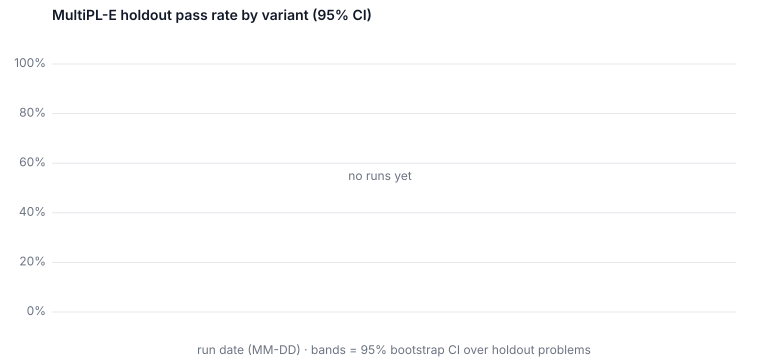

# self-improving-coder

A JavaScript coding agent that solves programming problems, is graded by real unit tests, and improves
its own **lessons**, **skills** and (optionally) **system prompt** once a day. It runs by itself on GitHub
Actions and costs nothing: the model is a small open-weights model (`qwen2.5-coder:0.5b`) served by
Ollama on the Actions runner itself.



> The chart fills in once the workflow has run. Blue = the champion's holdout pass rate, dashed orange =
> baseline (mean of the first two runs), green/red dots = gate accepted/rejected that day's changes,
> dashed grey = that day's train batch.

## What improved and why

_To be written from `state/scores.csv` after the week (`npm run summary` prints the numbers). Five lines:
start vs end holdout score with `n`, how many days the gate accepted / kept / rejected, which levers
(lessons, skills, prompt) the accepted changes contained, and the measured baseline noise._

## How it works

```
            ┌──────────── daily cron (GitHub Actions) ────────────┐
            │                                                     │
 problems ─►│ pick train batch ─► solve ─► run tests ─► pass? ────┼─► skill library
 (MultiPL-E)│                       ▲          │ fail             │
            │                       │          ▼                  │
            │                 retrieve    reflect ─► lesson       │
            │                 lessons ◄──────────────┘            │
            │                                                     │
            │ candidate state ─► holdout eval ─► gate ─► accept / keep / reject
            │                                         │           │
            └─────────────────────────────────────────┼───────────┘
                                                      ▼
                                   commit state + scores.csv + chart.svg
```

One cycle (`node src/run.js`):

1. Load config, state and the fixed train/holdout split (558 MultiPL-E HumanEval + MBPP problems in JS,
   80 held out).
2. **Train:** for unsolved train problems, up to 2 attempts each. Every prompt includes the top lessons and
   related solved functions found by keyword overlap. A pass is saved as a **skill**. A failure (assertion,
   crash or timeout, with the trimmed output) is turned into a short **lesson** by the same model.
3. **Candidate** = champion + pending + this run's new lessons/skills (+ a new prompt if phase 5 is on).
4. **Holdout eval:** champion and candidate both solve the same holdout problems at temperature 0. Tests
   are the only judge.
5. **Gate:** accept if the candidate is ≥ 2.5 points better, keep pending if within ±2.5, reject (and
   delete its new items) if worse.
6. Prune lessons above 60, append to `state/scores.csv`, redraw `chart.svg`.

The first two runs are **baseline runs**: they only measure the starting model on the holdout set, to
show how noisy the measurement is before any learning is accepted.

## Run it locally

```bash
npm ci
npm test                 # 53 tests, all against the mock LLM, no network, no model
npm run dry-run          # full cycle with the mock LLM + fixture problems; writes .dry-run/
```

With a real model (needs [Ollama](https://ollama.com)):

```bash
ollama pull qwen2.5-coder:0.5b
npm start                # downloads the dataset to data/, writes state/ and chart.svg
npm run summary          # per-run scores, gate decisions, baseline noise
```

## Turn it on in GitHub

1. Put this folder at the root of a **public** repository (public repos get free Actions minutes).
2. **Settings → Actions → General**: allow GitHub Actions. Leave "Workflow permissions" at the default;
   each job asks for exactly what it needs.
3. **Actions → improve → Run workflow** twice, a few minutes apart. These are the two baseline runs. Copy
   both numbers into `DECISIONS.md` §6 (or run `npm run summary` on the committed `state/scores.csv`).
4. From then on it runs daily at 04:17 UTC. Each run takes about 1–2 hours.

Optional repo **variables** (Settings → Secrets and variables → Actions → Variables):

| variable | meaning |
|---|---|
| `SIC_CONFIG_OVERRIDES` | JSON merged over `config/default.json`, e.g. `{"llm":{"model":"qwen2.5-coder:1.5b"},"budget":{"requestsPerRun":200}}` |
| `SIC_IMPROVE_TIMEOUT_MINUTES` | timeout of the job that runs the agent (default 150) |
| `SIC_COMMIT_TIMEOUT_MINUTES` | timeout of the job that commits state (default 10) |

Locally, every config key can also be set as an env var: `SIC_` + the key path in upper snake case,
with `__` between levels, e.g. `SIC_BUDGET__REQUESTS_PER_RUN=100`.

## Repo layout

```
config/default.json     every tunable (model, URLs, budgets, thresholds, paths, chart)
prompts/                solve / reflect prompt templates
src/run.js              one cycle
src/agent/              solve, reflect, retrieve, evolve (phase 5)
src/judge/run-tests.js  sandboxed test runner
src/llm/                openai-compatible client (Ollama) + deterministic mock
src/dataset/            MultiPL-E fetch (pinned) + seeded split
src/gate.js, budget.js, metrics.js, chart.js, memory.js
state/                  the agent's memory, committed by the workflow
test/                   node:test, mock provider only
```

## Security model

Two jobs, so the token that can write to the repo never meets LLM-written code:

- **`improve`** runs the model and the generated code. Its `GITHUB_TOKEN` has only `contents: read`, and
  checkout uses `persist-credentials: false`, so the token isn't even left in `.git/config`.
- **`commit`** has `contents: write`. It downloads the `state/` artifact, refuses symlinks, copies files, and
  pushes. It never runs anything from the artifact.

Each generated solution runs in a child `node` process with an **empty environment**, its own temp dir as
`cwd`, a 6-second timeout that kills the whole process group, a 256 MB heap cap, capped output, and Node's
**permission model**: file reads only inside its temp dir, no file writes, no child processes, no workers.

**What is still not isolated (honestly):**

- Same OS user as the agent. A Node permission-model bypass (they do get found) would expose the
  runner's files, including the agent's own state before upload.
- **No network isolation.** Generated code can open sockets (`node:net`, `fetch`). It has no credentials to
  send, but it could make outbound requests from the runner.
- Generated code ends up in `state/skills/` and is committed. It is shown to the model as text and never
  executed outside the sandbox, but it is unreviewed code in your repo.
- The model could write a lesson that is a prompt injection against later prompts. The holdout gate
  limits the damage to things that don't lower the score.

## Known weaknesses

- HumanEval-style problems are near-saturated for strong models; a 0.5B model is used on purpose so
  gains are visible at all.
- Small budget: about 360 model calls per day on a CPU runner. A week gives a modest curve, not a dramatic one.
- The model may have seen these problems in training. MBPP plus a strict holdout reduce this but don't remove it.
- Holdout sampling adds noise: 1 problem = 1.25 points on n=80. Every score is reported with `n`.
- Public-repo scheduled workflows are disabled automatically after 60 days without repository activity.
  The daily state commits are made by `github-actions[bot]`, which may not count as activity. Check the
  Actions tab if runs stop.
- GitHub Models (the original plan) was retired on 2026-07-30; see `DECISIONS.md` §1.
- The phase 5 prompt optimizer is implemented and unit-tested with stubs but hasn't been run against a real model yet.
